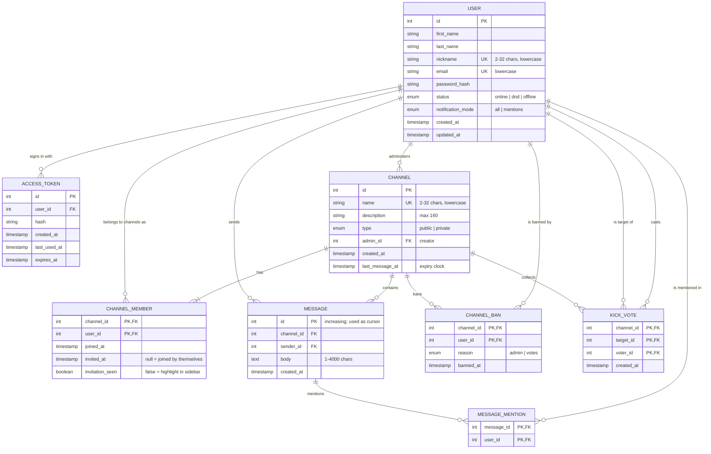

# Logical data model — Sideby chat

This model describes what the application stores, independent of a specific database.
It is derived from the working frontend prototype (`frontend/src/services/mock/workspace.js`)
and replaces the earlier drafts (`datamodel_draftV1.png`, `data_model_draftV1_alt.png` on `main`):

- Kept from draft V1: users, channels ("chats"), membership, messages.
- Dropped: phone numbers, attachments, workspaces, friendships, threaded replies — not part of the assignment and not used by the app.
- Added: channel type and administrator, invitations, bans, kick votes, user status, notification preference, last activity for 30-day channel expiry.

## Diagram

## Entities

### USER
A registered person. `nickname` and `email` are unique and stored lowercase (the app compares them case-insensitively). `status` is the user's chosen presence; `notification_mode` decides whether every message or only mentions produce a notification. The password is stored only as a hash.

### ACCESS_TOKEN
Sign-in tokens. Already exists in the backend (`auth_access_tokens`, AdonisJS). One user can be signed in on several devices.

### CHANNEL
A public or private conversation. `name` is unique among existing channels; deleting a channel frees the name. `admin_id` is the creator, who can delete the channel, invite to private channels, revoke members, and ban immediately. The administrator is also a row in CHANNEL_MEMBER. `last_message_at` is set at creation and by every new message; a channel without a message for more than 30 days is deleted.

### CHANNEL_MEMBER
Who belongs to which channel (many-to-many between USER and CHANNEL). Membership is what grants access to the channel and its messages.
`invited_at` and `invitation_seen` model invitations: an invitation adds the member immediately (current team decision) and the channel is highlighted until it is opened.

### MESSAGE
A message in a channel. `id` is increasing across the whole application, so it doubles as the pagination cursor: older history is `id < before`, catch-up after being offline is `id > after`, and new-message notifications use the newest id seen.

### MESSAGE_MENTION
Which members a message mentions (`@nickname`). Derived from the body when the message is saved. Used for mention highlighting and for "mentions only" notifications without re-parsing message text. Optional: the prototype derives mentions from the body on the fly.

### CHANNEL_BAN
Permanent removal from a public channel. Created by the administrator (`reason = admin`) or by the third distinct kick vote (`reason = votes`). Deleted when the administrator invites the user again.

### KICK_VOTE
One member's vote to remove another member from a public channel. The composite key (channel, target, voter) makes duplicate votes impossible. All votes for a target are deleted when the ban is created or lifted.

## Relationships

| Relationship | Cardinality | Note |
|---|---|---|
| USER — CHANNEL (administers) | 1 : N | every channel has exactly one administrator |
| USER — CHANNEL (member of) | M : N | through CHANNEL_MEMBER; a channel always has at least its administrator |
| CHANNEL — MESSAGE | 1 : N | deleting a channel deletes its messages |
| USER — MESSAGE (sends) | 1 : N | |
| MESSAGE — USER (mentions) | M : N | through MESSAGE_MENTION |
| CHANNEL — USER (bans) | M : N | through CHANNEL_BAN |
| KICK_VOTE | ternary | channel, target user, voting user |

## Business rules (enforced by the application)

1. Names: nickname and channel name are 2–32 characters, letters, digits, `-` and `_`, starting with a letter or digit, stored lowercase.
2. Only members can read a channel's messages, members, or drafts.
3. Private channels: only the administrator invites (`/invite`) and removes (`/revoke`). Revoking deletes the membership but does not ban.
4. Public channels: any member may invite. `/kick` by the administrator creates a CHANNEL_BAN at once; by anyone else it adds a KICK_VOTE, and the 3rd distinct voter creates the ban.
5. Nobody can kick or revoke themselves or the administrator.
6. A banned user cannot join; only the administrator's invitation lifts the ban (deletes the CHANNEL_BAN and the target's KICK_VOTEs).
7. When the administrator leaves, the channel and all its dependent rows are deleted. Another member leaving deletes only their CHANNEL_MEMBER row.
8. A message body has 1–4000 characters after trimming.
9. A channel whose `last_message_at` is more than 30 days old is deleted with all dependent rows; its name becomes available again.

## Deliberately not stored

| Data | Why |
|---|---|
| Typing state and live drafts | Live only: sent to channel members in real time and discarded. Persisting every keystroke has no value after the draft is sent or deleted. |
| Offline "waiting updates" count | Client state; catch-up asks for messages with `id > newest id the client has`. |
| Browser notification permission | Belongs to the browser, not the account. |

## Changes needed in the backend

The existing `users` migration has `full_name`, `email`, `password`. To match this model it needs `first_name`, `last_name`, a unique `nickname`, `status` and `notification_mode`; the other tables are new.
